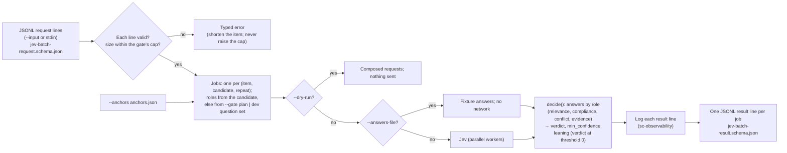

# `judge-jev batch`: the low layer

Reader: anyone sending Jev requests that are not quality, drift or compare
(plan and dev gates), or debugging what those commands send.

`quality`, `drift` and `compare-definition` compose their own requests and
send them through the same job runner; `drift` reads its own verdict from the
answers (see [drift.md](drift.md)), not `decide()`.
