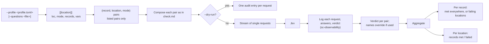

# `judge-jev check --profile`: fan-out and aggregation

No extra prompt is composed here: each pair is composed exactly as in
[check.md](check.md). The report holds every pair's verdict plus both
aggregates.
