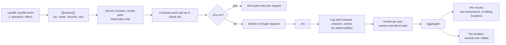

# `judge-jev check --profile`: fan-out and aggregation

> **Planned, not in this release.** `check` (compliance: does code or a prompt meet its record) has no subcommand in `jev_judge.py`; this diagram is its design.

No extra prompt is composed here: each pair is composed exactly as in
[check.md](check.md). The report holds every pair's verdict plus both
aggregates.
