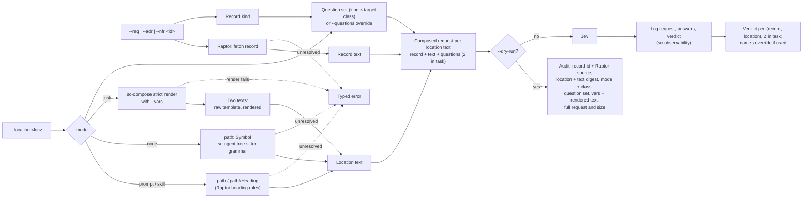

# `judge-jev check`: Jev prompt composition

> **Planned, not in this release.** `check` (compliance: does code or a prompt meet its record) has no subcommand in `jev_judge.py`; this diagram is its design.

`code` mode waits for sc-agent's grammars (ADR-JEV-0004).
