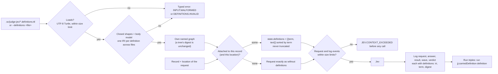

# Definitions: from file to request

A record-only attachment puts the definition in every request about the
record; a record-and-location attachment puts it only in a request made at
that location. Shipped question wording is never changed.
