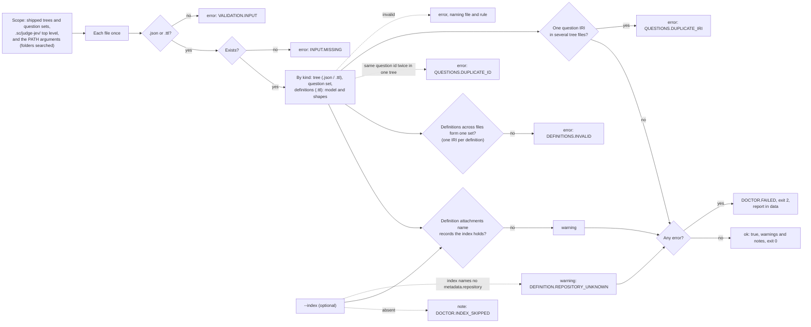

# `judge-jev doctor`: check everything judge-jev loads

Reader: anyone who changed a tree, a question set or a definitions file and
wants to know it loads before any Jev call.

Calls nothing, needs no key, writes no log. A `path::Symbol` location is
checked for its file only.
