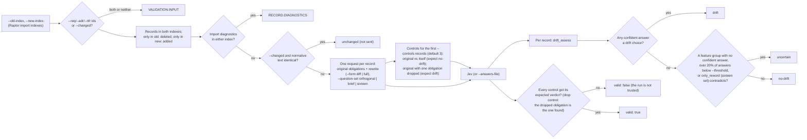

# `judge-jev drift`: does a rewrite still require what the original did?

Reader: anyone rewriting records (by hand, by the fix workflow or by the write
workflow) who must show that no obligation was added, dropped or changed.

List questions (a new measure, a new definition) never decide; a confident
yes is reported under `listed`. A contradiction with `only_reword` makes the
record uncertain even when a drift answer was confident.
