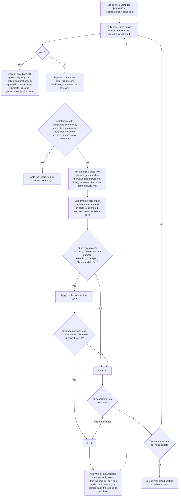

# Fix workflow (`references/fix-strategy.md`)

Reader: an agent or person fixing one record that fails the gate; the owner
reviewing what such an agent did. This is the workflow as shipped (unchanged in 0.8.1).

Rules: obligations do not change; nothing is invented; no checked-by clause;
the gate is not edited; no record or statement is removed to make a record
pass.
