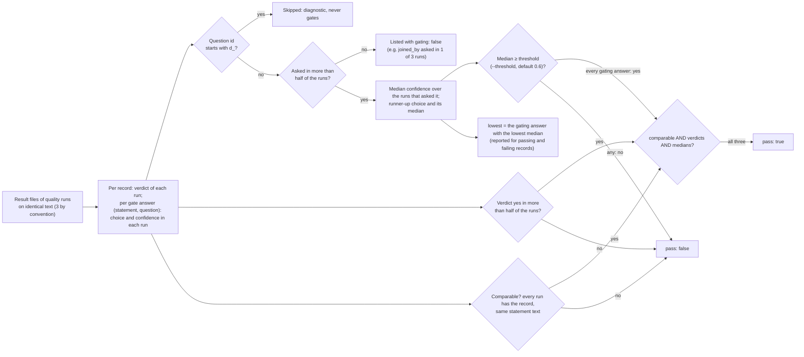

# `jev_gate.py`: when a record passes

Reader: anyone deciding whether a judged record is accepted, or reading why it was not.

With three runs, "more than half" is two. `jev_gate.py` exits 0 whenever it
computed the gate, failing records included; a record whose runs judged
different text is not comparable and does not pass. The fix and write
workflows ([fix.md](fix.md), [write.md](write.md)) call this gate as their
`verify` step.
