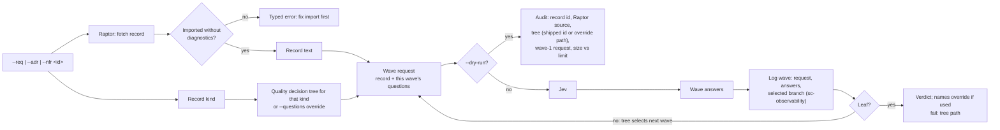

# `judge-jev quality`: Jev prompt composition

Each wave is one request carrying several questions about the same record.
Answers pick the next wave from the shipped tree; no model chooses questions.
A dry run composes wave 1 only, since later waves depend on live answers.
