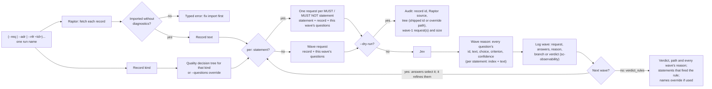

# `judge-jev quality`: Jev prompt composition

Reader: anyone running `quality` who needs to know what is sent to Jev and what comes back.

Each wave is one request carrying several questions about the same record,
and reports every question's answer as its reason. A per-statement wave
sends one such request per MUST / MUST NOT statement and reports each
statement's answers; its rules fire when any one statement matches. Answers
pick the next wave from the tree, and a wave with no next wave gives the
verdict by the tree's rule; no model chooses questions. A dry run composes
wave 1 only, since later waves depend on live answers.

What each tree asks, and how its answers become a verdict, is generated from
the tree files: [trees/quality-req.md](trees/quality-req.md),
[trees/quality-nfr.md](trees/quality-nfr.md),
[trees/quality-adr.md](trees/quality-adr.md), and the diagnostic trees
[trees/diag-req.md](trees/diag-req.md), [trees/diag-nfr.md](trees/diag-nfr.md),
[trees/diag-adr.md](trees/diag-adr.md). One run's verdict is not a pass: the
gate over three runs is [gate.md](gate.md).

## What 0.8.0 changed in the REQ and NFR trees (#137, #138)

| | 0.7.0 | 0.8.0 |
| --- | --- | --- |
| Wave 1 gate questions | `obligations`, `joined_by`, `term` (5 choices, 2 acceptable), `check` (5 choices, 3 acceptable) | `obligations`, `term` (yes / no), `checkable` (yes / needs a measure / no) |
| `joined_by` | wave 1, asked of every statement | wave 2, asked only of statements with `obligations` 2 or more |
| Old 5-way questions | gate | kept as diagnostics `d_term_kind`, `d_check_method` (never gate) |
| Gate (`jev_gate.py`) | every answer over all runs | an answer asked in only some runs is scored over those runs and gates only when more than half asked it |

Why: a question with two acceptable answers lets Jev split its confidence
between them (unit test 0.53, inspection 0.42), so the top answer fell under
0.6 although Jev was sure the statement could be checked. A yes/no gate
question has one acceptable answer. The ADR tree did not change.
