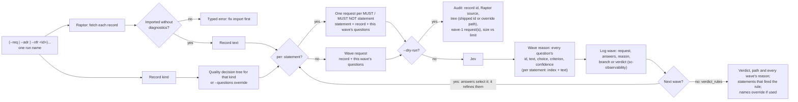

# `judge-jev quality`: Jev prompt composition

Each wave is one request carrying several questions about the same record,
and reports every question's answer as its reason. A per-statement wave
sends one such request per MUST / MUST NOT statement and reports each
statement's answers; its rules fire when any one statement matches. Answers pick the next
wave from the tree, and a wave with no next wave gives the verdict by the
tree's rule; no model chooses questions. The shipped trees hold wave 1
only: a wave 2 is designed from wave 1's observed answers. A dry run
composes wave 1 only, since later waves depend on live answers.
