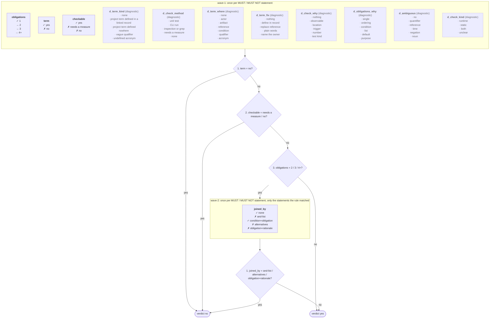

<!-- Generated by scripts/gen_tree_diagrams.py from plugins/sc-judge-jev/install/templates/skills/judge-jev/assets/questions/diag-nfr.json. Do not edit; rerun the script. -->
# Tree `diag-nfr` (NFR)

Reader: anyone judging or fixing a NFR record who needs to know what Jev is asked and why a
verdict came out as it did. Source: [`diag-nfr.json`](../../../plugins/sc-judge-jev/install/templates/skills/judge-jev/assets/questions/diag-nfr.json).

Marks: ✓ acceptable, ✗ gives verdict no, → asks the next wave, · diagnostic (never gates).
Rules are tried in order; the first that matches decides. In a per-statement wave a rule matches when any one
statement matches it.

- Gate questions: `obligations`, `term`, `checkable`, `joined_by`.
- Diagnostic questions: `d_term_kind`, `d_check_method`, `d_term_where`, `d_term_fix`, `d_check_why`, `d_obligations_why`, `d_ambiguous`, `d_check_kind`. They explain a weak answer and never gate.
- The pass gate over three runs is in [../gate.md](../gate.md).
