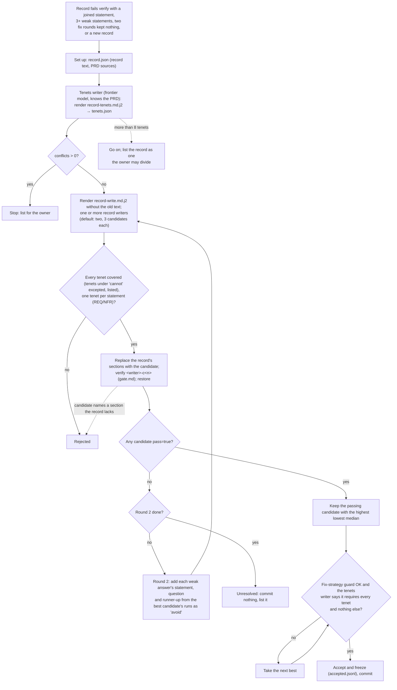

# Write workflow (`references/write-records.md`)

Reader: an agent or person rewriting a record whose problems are structural
(a joined statement, or many weak statements), or writing a new one.

The coordinator fills templates only from files, never rewords a tenet and
never picks a candidate by reading it. Writers never see Jev's scores.
Never use this on an accepted record: an accepted record is frozen.
