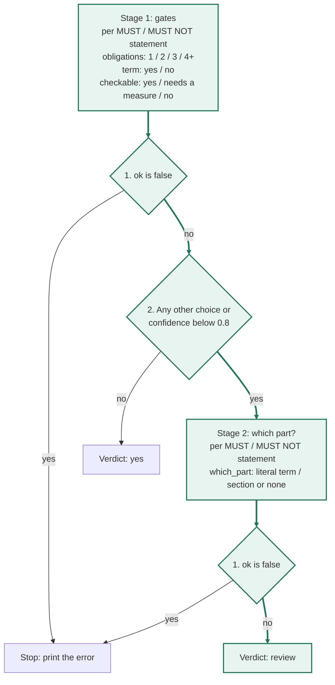
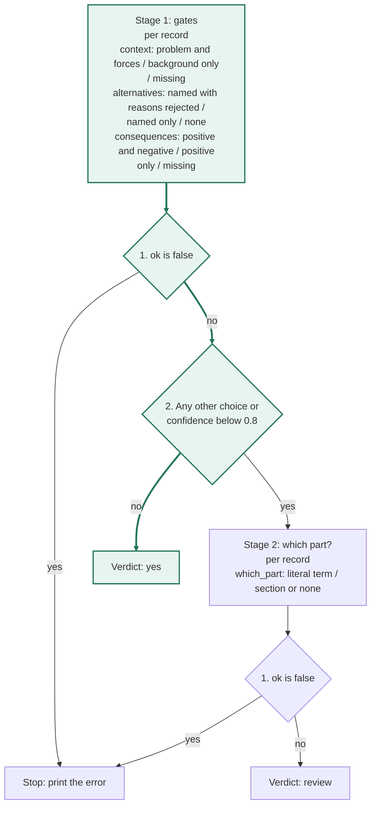

# decidr-pipeline — decision report

Results from this live example run.

Source revision: `bcf229e969ede8d22f4c6bb497501e393bf31b85`. Captured: 2026-11-25T21:21:07.064411+00:00.

The highlighted path is reconstructed from recorded branches and answers.

Review means a gate answer is under this example's bar (0.8 confidence or an accepted-choice rule). It needs follow-up; it is not a judge-jev quality failure.

Execution locations use placeholders such as `{repo}` and `{tmp}`; model response values are unchanged.

## Raptor import diagnostics

These records were not selected for the live examples:

- `REQ-JEV-0003`: MODAL_MISMATCH at docs/requirements/raptor-integration.md:113 — Found 'MUST NOT' in a statement under 'MUST statements'; expected 'MUST' or no keyword. The label's modal is kept.

## Commands

```bash
bash -o pipefail -c 'scripts=$1
job=$2
first_model=$3
second_model=$4
bar=$5
decidr send --project decidr-question-tree --model "$first_model" --agent-role skill-author < "$job/request.json" \
  | tee "$job/gates.jsonl" \
  | jq -c --slurpfile item "$job/item.json" --slurpfile terms "$job/terms.json" --slurpfile tree "$job/tree.json" --argjson bar "$bar" -f "$scripts/next.jq" \
  | tee "$job/next.jsonl" \
  | bash "$scripts/send-next.sh" "$second_model" --project decidr-question-tree --agent-role skill-author \
  | tee "$job/stage2.jsonl" \
  | jq -c -f "$scripts/verdict.jq" > "$job/verdict.jsonl"
' decidr-pipeline '{repo}/plugins/sc-judge-jev/skills/walking-decidr-trees/scripts' '{run}/REQ-JEV-0001.s1' jev jev 0.8
```
Exit status: 0.

```bash
bash -o pipefail -c 'scripts=$1
job=$2
first_model=$3
second_model=$4
bar=$5
decidr send --project decidr-question-tree --model "$first_model" --agent-role skill-author < "$job/request.json" \
  | tee "$job/gates.jsonl" \
  | jq -c --slurpfile item "$job/item.json" --slurpfile terms "$job/terms.json" --slurpfile tree "$job/tree.json" --argjson bar "$bar" -f "$scripts/next.jq" \
  | tee "$job/next.jsonl" \
  | bash "$scripts/send-next.sh" "$second_model" --project decidr-question-tree --agent-role skill-author \
  | tee "$job/stage2.jsonl" \
  | jq -c -f "$scripts/verdict.jq" > "$job/verdict.jsonl"
' decidr-pipeline '{repo}/plugins/sc-judge-jev/skills/walking-decidr-trees/scripts' '{run}/REQ-JEV-0001.s2' jev jev 0.8
```
Exit status: 0.

```bash
bash -o pipefail -c 'scripts=$1
job=$2
first_model=$3
second_model=$4
bar=$5
decidr send --project decidr-question-tree --model "$first_model" --agent-role skill-author < "$job/request.json" \
  | tee "$job/gates.jsonl" \
  | jq -c --slurpfile item "$job/item.json" --slurpfile terms "$job/terms.json" --slurpfile tree "$job/tree.json" --argjson bar "$bar" -f "$scripts/next.jq" \
  | tee "$job/next.jsonl" \
  | bash "$scripts/send-next.sh" "$second_model" --project decidr-question-tree --agent-role skill-author \
  | tee "$job/stage2.jsonl" \
  | jq -c -f "$scripts/verdict.jq" > "$job/verdict.jsonl"
' decidr-pipeline '{repo}/plugins/sc-judge-jev/skills/walking-decidr-trees/scripts' '{run}/REQ-JEV-0001.s3' jev jev 0.8
```
Exit status: 0.

```bash
bash -o pipefail -c 'scripts=$1
job=$2
first_model=$3
second_model=$4
bar=$5
decidr send --project decidr-question-tree --model "$first_model" --agent-role skill-author < "$job/request.json" \
  | tee "$job/gates.jsonl" \
  | jq -c --slurpfile item "$job/item.json" --slurpfile terms "$job/terms.json" --slurpfile tree "$job/tree.json" --argjson bar "$bar" -f "$scripts/next.jq" \
  | tee "$job/next.jsonl" \
  | bash "$scripts/send-next.sh" "$second_model" --project decidr-question-tree --agent-role skill-author \
  | tee "$job/stage2.jsonl" \
  | jq -c -f "$scripts/verdict.jq" > "$job/verdict.jsonl"
' decidr-pipeline '{repo}/plugins/sc-judge-jev/skills/walking-decidr-trees/scripts' '{run}/ADR-JEV-0001' jev jev 0.8
```
Exit status: 0.

```bash
bash -o pipefail -c 'scripts=$1
job=$2
first_model=$3
second_model=$4
bar=$5
decidr send --project decidr-question-tree --model "$first_model" --agent-role skill-author < "$job/request.json" \
  | tee "$job/gates.jsonl" \
  | jq -c --slurpfile item "$job/item.json" --slurpfile terms "$job/terms.json" --slurpfile tree "$job/tree.json" --argjson bar "$bar" -f "$scripts/next.jq" \
  | tee "$job/next.jsonl" \
  | bash "$scripts/send-next.sh" "$second_model" --project decidr-question-tree --agent-role skill-author \
  | tee "$job/stage2.jsonl" \
  | jq -c -f "$scripts/verdict.jq" > "$job/verdict.jsonl"
' decidr-pipeline '{repo}/plugins/sc-judge-jev/skills/walking-decidr-trees/scripts' '{run}/NFR-JEV-0001.s1' jev jev 0.8
```
Exit status: 0.

```bash
bash -o pipefail -c 'scripts=$1
job=$2
first_model=$3
second_model=$4
bar=$5
decidr send --project decidr-question-tree --model "$first_model" --agent-role skill-author < "$job/request.json" \
  | tee "$job/gates.jsonl" \
  | jq -c --slurpfile item "$job/item.json" --slurpfile terms "$job/terms.json" --slurpfile tree "$job/tree.json" --argjson bar "$bar" -f "$scripts/next.jq" \
  | tee "$job/next.jsonl" \
  | bash "$scripts/send-next.sh" "$second_model" --project decidr-question-tree --agent-role skill-author \
  | tee "$job/stage2.jsonl" \
  | jq -c -f "$scripts/verdict.jq" > "$job/verdict.jsonl"
' decidr-pipeline '{repo}/plugins/sc-judge-jev/skills/walking-decidr-trees/scripts' '{run}/NFR-JEV-0001.s2' jev jev 0.8
```
Exit status: 0.

```bash
bash -o pipefail -c 'scripts=$1
job=$2
first_model=$3
second_model=$4
bar=$5
decidr send --project decidr-question-tree --model "$first_model" --agent-role skill-author < "$job/request.json" \
  | tee "$job/gates.jsonl" \
  | jq -c --slurpfile item "$job/item.json" --slurpfile terms "$job/terms.json" --slurpfile tree "$job/tree.json" --argjson bar "$bar" -f "$scripts/next.jq" \
  | tee "$job/next.jsonl" \
  | bash "$scripts/send-next.sh" "$second_model" --project decidr-question-tree --agent-role skill-author \
  | tee "$job/stage2.jsonl" \
  | jq -c -f "$scripts/verdict.jq" > "$job/verdict.jsonl"
' decidr-pipeline '{repo}/plugins/sc-judge-jev/skills/walking-decidr-trees/scripts' '{run}/NFR-JEV-0001.s3' jev jev 0.8
```
Exit status: 0.

```bash
bash -o pipefail -c 'scripts=$1
job=$2
first_model=$3
second_model=$4
bar=$5
decidr send --project decidr-question-tree --model "$first_model" --agent-role skill-author < "$job/request.json" \
  | tee "$job/gates.jsonl" \
  | jq -c --slurpfile item "$job/item.json" --slurpfile terms "$job/terms.json" --slurpfile tree "$job/tree.json" --argjson bar "$bar" -f "$scripts/next.jq" \
  | tee "$job/next.jsonl" \
  | bash "$scripts/send-next.sh" "$second_model" --project decidr-question-tree --agent-role skill-author \
  | tee "$job/stage2.jsonl" \
  | jq -c -f "$scripts/verdict.jq" > "$job/verdict.jsonl"
' decidr-pipeline '{repo}/plugins/sc-judge-jev/skills/walking-decidr-trees/scripts' '{run}/NFR-JEV-0001.s4' jev jev 0.8
```
Exit status: 0.

## REQ-JEV-0001.s1 — Records come from Raptor

judge-jev MUST obtain records through Raptor's query interface.

**Verdict:** review. **Path:** gates → which-part → review.



| Wave / item | Question | Choice | Confidence | Role |
|---|---|---|---:|---|
| gates / REQ-JEV-0001.s1 | checkable | yes | 96% | accepted |
| gates / REQ-JEV-0001.s1 | obligations | 1 | 99% | accepted |
| gates / REQ-JEV-0001.s1 | term | yes | 38% | under bar |
| which-part / REQ-JEV-0001.s1 | which_part | none | 29% | diagnostic |

## REQ-JEV-0001.s2 — Records come from Raptor

judge-jev MUST NOT parse record Markdown itself.

**Verdict:** review. **Path:** gates → which-part → review.


| Wave / item | Question | Choice | Confidence | Role |
|---|---|---|---:|---|
| gates / REQ-JEV-0001.s2 | checkable | yes | 98% | accepted |
| gates / REQ-JEV-0001.s2 | obligations | 1 | 100% | accepted |
| gates / REQ-JEV-0001.s2 | term | yes | 30% | under bar |
| which-part / REQ-JEV-0001.s2 | which_part | none | 37% | diagnostic |

## REQ-JEV-0001.s3 — Records come from Raptor

judge-jev MUST NOT run SQL (Structured Query Language) against the record
store itself.

**Verdict:** review. **Path:** gates → which-part → review.


| Wave / item | Question | Choice | Confidence | Role |
|---|---|---|---:|---|
| gates / REQ-JEV-0001.s3 | checkable | yes | 98% | accepted |
| gates / REQ-JEV-0001.s3 | obligations | 1 | 100% | accepted |
| gates / REQ-JEV-0001.s3 | term | yes | 46% | under bar |
| which-part / REQ-JEV-0001.s3 | which_part | SQL | 30% | diagnostic |

## ADR-JEV-0001 — Keep the Jev core unchanged until its Rust replacement

The Jev core keeps its architecture and contracts unchanged. It changes
only to fix a defect, or to replace its run log with the sc-observability
logger (REQ-JEV-0008).

**Verdict:** yes. **Path:** gates → yes.



| Wave / item | Question | Choice | Confidence | Role |
|---|---|---|---:|---|
| gates / ADR-JEV-0001 | alternatives | named with reasons rejected | 100% | accepted |
| gates / ADR-JEV-0001 | consequences | positive and negative | 97% | accepted |
| gates / ADR-JEV-0001 | context | problem and forces | 97% | accepted |

## NFR-JEV-0001.s1 — Deterministic offline tests

judge-jev tests MUST run offline against recorded Jev answers.

**Verdict:** review. **Path:** gates → which-part → review.


| Wave / item | Question | Choice | Confidence | Role |
|---|---|---|---:|---|
| gates / NFR-JEV-0001.s1 | checkable | yes | 96% | accepted |
| gates / NFR-JEV-0001.s1 | obligations | 1 | 48% | under bar |
| gates / NFR-JEV-0001.s1 | term | yes | 62% | under bar |
| which-part / NFR-JEV-0001.s1 | which_part | none | 35% | diagnostic |

## NFR-JEV-0001.s2 — Deterministic offline tests

judge-jev tests MUST NOT depend on timing.

**Verdict:** review. **Path:** gates → which-part → review.


| Wave / item | Question | Choice | Confidence | Role |
|---|---|---|---:|---|
| gates / NFR-JEV-0001.s2 | checkable | yes | 62% | under bar |
| gates / NFR-JEV-0001.s2 | obligations | 1 | 100% | accepted |
| gates / NFR-JEV-0001.s2 | term | yes | 60% | under bar |
| which-part / NFR-JEV-0001.s2 | which_part | timing | 54% | diagnostic |

## NFR-JEV-0001.s3 — Deterministic offline tests

judge-jev tests MUST NOT depend on sleeps.

**Verdict:** review. **Path:** gates → which-part → review.


| Wave / item | Question | Choice | Confidence | Role |
|---|---|---|---:|---|
| gates / NFR-JEV-0001.s3 | checkable | yes | 89% | accepted |
| gates / NFR-JEV-0001.s3 | obligations | 1 | 100% | accepted |
| gates / NFR-JEV-0001.s3 | term | yes | 54% | under bar |
| which-part / NFR-JEV-0001.s3 | which_part | sleeps | 40% | diagnostic |

## NFR-JEV-0001.s4 — Deterministic offline tests

judge-jev tests MUST NOT depend on ordering.

**Verdict:** review. **Path:** gates → which-part → review.


| Wave / item | Question | Choice | Confidence | Role |
|---|---|---|---:|---|
| gates / NFR-JEV-0001.s4 | checkable | yes | 83% | accepted |
| gates / NFR-JEV-0001.s4 | obligations | 1 | 100% | accepted |
| gates / NFR-JEV-0001.s4 | term | yes | 60% | under bar |
| which-part / NFR-JEV-0001.s4 | which_part | ordering | 40% | diagnostic |
