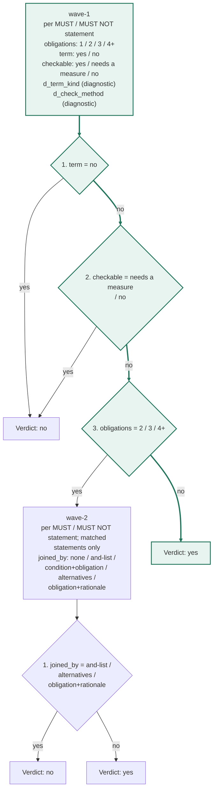
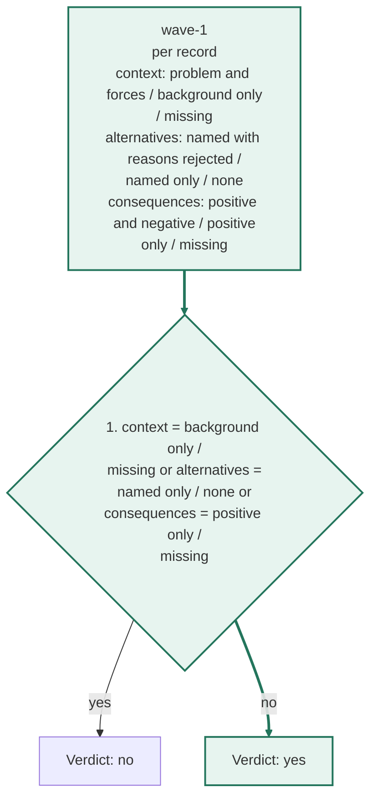

# judge-jev-quality — decision report

Recorded live responses; rendering this report does not send model requests.

Source revision: `c823e4600cbbee7f987cc2e65485f7c8deb6da92`. Captured: 2026-11-25T19:59:16.734522+00:00.

The highlighted path is reconstructed from recorded branches and answers.

## Raptor import diagnostics

These records were not selected for the live examples:

- `REQ-JEV-0003`: MODAL_MISMATCH at docs/requirements/raptor-integration.md:113 — Found 'MUST NOT' in a statement under 'MUST statements'; expected 'MUST' or no keyword. The label's modal is kept.

## Commands

```bash
uv run --python 3.11 --script /private/tmp/decidr-repo-example.n7y7yg/installed/.claude/skills/judge-jev/scripts/jev_judge.py quality --index /private/tmp/decidr-repo-example.n7y7yg/index.json --repository-root /Users/randlee/github/judge-jev-worktrees/feat/decidr-question-tree --run-name quality-example-live --req REQ-JEV-0001 --adr ADR-JEV-0001 --nfr NFR-JEV-0001
```
Exit status: 0.

## REQ-JEV-0001 — Records come from Raptor

judge-jev MUST obtain records through Raptor's query interface.
judge-jev MUST NOT parse record Markdown itself.
judge-jev MUST NOT run SQL (Structured Query Language) against the record
store itself.

**Verdict:** yes. **Path:** wave-1 → yes.



| Wave / item | Question | Choice | Confidence | Role |
|---|---|---|---:|---|
| wave-1 / REQ-JEV-0001.s1 | obligations | 1 | 99% | gate |
| wave-1 / REQ-JEV-0001.s1 | term | yes | 28% | gate |
| wave-1 / REQ-JEV-0001.s1 | checkable | yes | 96% | gate |
| wave-1 / REQ-JEV-0001.s1 | d_term_kind | none | 64% | diagnostic |
| wave-1 / REQ-JEV-0001.s1 | d_check_method | inspection or grep | 70% | diagnostic |
| wave-1 / REQ-JEV-0001.s2 | obligations | 1 | 100% | gate |
| wave-1 / REQ-JEV-0001.s2 | term | yes | 32% | gate |
| wave-1 / REQ-JEV-0001.s2 | checkable | yes | 98% | gate |
| wave-1 / REQ-JEV-0001.s2 | d_term_kind | none | 77% | diagnostic |
| wave-1 / REQ-JEV-0001.s2 | d_check_method | inspection or grep | 99% | diagnostic |
| wave-1 / REQ-JEV-0001.s3 | obligations | 1 | 97% | gate |
| wave-1 / REQ-JEV-0001.s3 | term | yes | 40% | gate |
| wave-1 / REQ-JEV-0001.s3 | checkable | yes | 98% | gate |
| wave-1 / REQ-JEV-0001.s3 | d_term_kind | none | 66% | diagnostic |
| wave-1 / REQ-JEV-0001.s3 | d_check_method | inspection or grep | 100% | diagnostic |

## ADR-JEV-0001 — Keep the Jev core unchanged until its Rust replacement

The Jev core keeps its architecture and contracts unchanged. It changes
only to fix a defect, or to replace its run log with the sc-observability
logger (REQ-JEV-0008).

**Verdict:** yes. **Path:** wave-1.



| Wave / item | Question | Choice | Confidence | Role |
|---|---|---|---:|---|
| wave-1 / ADR-JEV-0001 | context | problem and forces | 98% | gate |
| wave-1 / ADR-JEV-0001 | alternatives | named with reasons rejected | 100% | gate |
| wave-1 / ADR-JEV-0001 | consequences | positive and negative | 100% | gate |

## NFR-JEV-0001 — Deterministic offline tests

judge-jev tests MUST run offline against recorded Jev answers.
judge-jev tests MUST NOT depend on timing.
judge-jev tests MUST NOT depend on sleeps.
judge-jev tests MUST NOT depend on ordering.

**Verdict:** yes. **Path:** wave-1 → yes.


| Wave / item | Question | Choice | Confidence | Role |
|---|---|---|---:|---|
| wave-1 / NFR-JEV-0001.s1 | obligations | 1 | 56% | gate |
| wave-1 / NFR-JEV-0001.s1 | term | yes | 68% | gate |
| wave-1 / NFR-JEV-0001.s1 | checkable | yes | 97% | gate |
| wave-1 / NFR-JEV-0001.s1 | d_term_kind | none | 84% | diagnostic |
| wave-1 / NFR-JEV-0001.s1 | d_check_method | CLI run | 36% | diagnostic |
| wave-1 / NFR-JEV-0001.s2 | obligations | 1 | 99% | gate |
| wave-1 / NFR-JEV-0001.s2 | term | yes | 62% | gate |
| wave-1 / NFR-JEV-0001.s2 | checkable | yes | 72% | gate |
| wave-1 / NFR-JEV-0001.s2 | d_term_kind | none | 51% | diagnostic |
| wave-1 / NFR-JEV-0001.s2 | d_check_method | inspection or grep | 69% | diagnostic |
| wave-1 / NFR-JEV-0001.s3 | obligations | 1 | 100% | gate |
| wave-1 / NFR-JEV-0001.s3 | term | yes | 58% | gate |
| wave-1 / NFR-JEV-0001.s3 | checkable | yes | 89% | gate |
| wave-1 / NFR-JEV-0001.s3 | d_term_kind | none | 84% | diagnostic |
| wave-1 / NFR-JEV-0001.s3 | d_check_method | inspection or grep | 92% | diagnostic |
| wave-1 / NFR-JEV-0001.s4 | obligations | 1 | 100% | gate |
| wave-1 / NFR-JEV-0001.s4 | term | yes | 66% | gate |
| wave-1 / NFR-JEV-0001.s4 | checkable | yes | 80% | gate |
| wave-1 / NFR-JEV-0001.s4 | d_term_kind | none | 51% | diagnostic |
| wave-1 / NFR-JEV-0001.s4 | d_check_method | inspection or grep | 62% | diagnostic |
